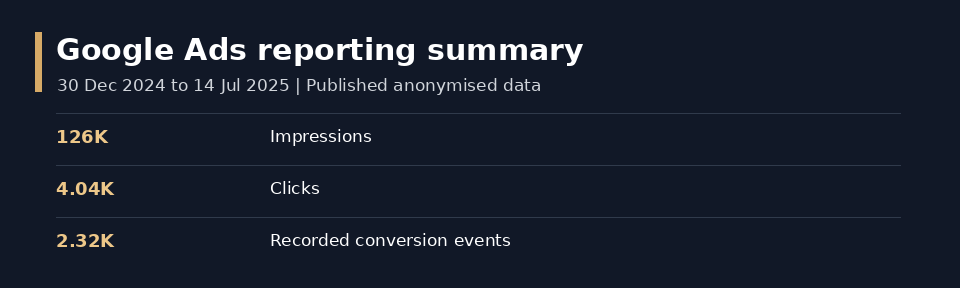

# Dr. Lara Eros Farbactian

### Founder of Vista by Lara and Quantara · Dubai, UAE

**Business turnaround · Sales recovery · New business opportunities**

    
  

   

---

I create opportunities. I step in when companies keep losing sales and money, and I build the strategy to turn them around before those losses put the business beyond recovery.

I find where sales leak, what makes buyers walk away, and which opportunities the business is losing. Then I fix what’s costing the company business and create new routes to buyers, partnerships and revenue. I build that strategy around the company, its market and what it takes to win business again.

[Discuss a project](https://www.vistabylara.com/contact) · [نبذة عن لارا بالعربية](https://www.vistabylara.com/ar/about)

 

## Executive profile and leadership experience

| Role | Focus |
| --- | --- |
| **Founder, Vista by Lara** | I founded Vista in 2024 to bring commercial development and digital delivery together. I lead projects across B2B sales, websites and e-commerce, technical SEO, AI visibility and business automation. |
| **Founder, Quantara** | Quantara applies software to construction documentation and quantity workflows. The BOQ project brings drawing intake, quantity review, revisions and rate data into one workflow, with professional review built into the process. |
| **Vice President and Business Development Manager, Provance Decoration & Interior Design** | I work on UAE fit-out growth, strategic partnerships, supplier opportunities and practical AI adoption. Vista’s published case covers B2B website work and government supplier-listing support. |
| **Earlier career** | My experience spans UAE and GCC government, semi-government and private-sector partnerships. In healthcare, my work has included doctor branding, medical-equipment business development and clinic partnerships. |

[Founder biography and career record](https://www.vistabylara.com/about) · [Provance project and public evidence](https://www.vistabylara.com/case-studies/provance)

## Key Proven Engineering Metrics with AI

- 🔎 **Up to 15 public pages per readiness scan** — Vista’s AI Visibility Readiness Checker reviews crawl access, structured data and content readiness, then returns evidence and prioritised fixes. [Run the checker](https://www.vistabylara.com/ai-visibility-audit)
- 🧪 **6 dated Google AI Mode tests across 2 languages** — Vista tested three buyer tasks in English and Arabic on 14 November 2026, recording which providers and cited sources appeared for AI visibility, bilingual indexing and Shopify SEO questions. [Read the findings](https://www.vistabylara.com/blog/google-ai-mode-dubai-english-arabic-test)
- 🌐 **3,316 searchable prompt records** — Vista’s UAE library combines an attributed upstream catalogue with Vista’s own English and Arabic templates. The public repository documents attribution and the human review workflow for Arabic translations. [Open the prompt library](https://www.vistabylara.com/tools/uae-ai-prompts) · [View the repository](https://github.com/vistabylara-dev/uae-ai-prompt-library)
- 🏗️ **Quantara AI BOQ construction workflow** — The project documentation covers drawing intake, quantity review, rate data, BOQ revisions and proposal workflows. Its architecture uses Next.js, TypeScript, PostgreSQL and Prisma, with professional review built into the quantity workflow. [Inspect the project documentation](https://github.com/vistabylara-dev/quantara-ai-boq)

## Key career metrics and documented results

| Published figure | Context |
| --- | --- |
| **20 years of professional experience** | Career experience across leadership roles, teams and markets. [Career record](https://www.vistabylara.com/about) |
| **4,000+ websites and 7,000+ B2B partnership contracts** | Vista’s founder biography reports these figures across my career and the teams I worked with, including work before Vista was established. [Career record](https://www.vistabylara.com/about) |
| **8 annual hotel flower-supply contracts** | Vista’s hospitality case study reports this result across wider client work and describes the supplier-development approach. [Case study](https://www.vistabylara.com/case-studies/luxurious-flower) |
| **13 anonymised advertising snapshots** | The lead Google Ads record for 30 December 2024 through 14 July 2025 shows 126K impressions, 4.04K clicks and 2.32K recorded conversion events. [Reporting evidence](https://www.vistabylara.com/case-studies/anonymous-google-ads-june-2025) |
| **6 Google AI Mode observations in English and Arabic** | Vista tested three buying tasks in both languages on 14 November 2026, recording which providers and sources appeared. [Dated research](https://www.vistabylara.com/blog/google-ai-mode-dubai-english-arabic-test) |

## Awards and professional credentials

- **2026 Global Brand Awards** — Vista by Lara lists an award for Excellence in Integrated Digital Marketing & Business Development. [Vista announcement](https://www.vistabylara.com/) · [Global Brands Magazine listing](https://www.globalbrandsmagazine.com/award-winners-2026/?id=650&cat_id=30205)
- **Provance AI Room Visualizer** — The published Provance case links the awards record crediting my role in corporate strategy for the project. [Project credits and recognition](https://www.vistabylara.com/case-studies/provance)
## Partner badges and certifications

| Platform | Career recognition |
| --- | --- |
| **Shopify** | Shopify Partner badge (2015). |
| **Google** | Google Premier Partner badge (2023), Google Ads Certified Partner and Google Partner approved-agency badges. |
| **Meta** | Meta Business Partner badge. |
| **TikTok** | TikTok Partner, reported in my career history. |

[View the published career badge gallery](https://www.vistabylara.com/about)

**Google Skillshop credentials**

- [Google Ads Search](https://skillshop.credential.net/3e05a821-71c8-4b95-a43b-9295c7091006)
- [Google Analytics](https://skillshop.credential.net/563667f8-7b37-4596-a345-747735fb32ed)
- [Campaign Manager 360](https://skillshop.credential.net/c31fdc67-802d-4e43-9dd3-e9e31ac86d15)
- [AI-Powered Performance Ads](https://skillshop.credential.net/4c49fdf6-9ac1-4705-8754-2b7db48ec75)
- [Conversion Optimization](https://skillshop.credential.net/df3aabc5-5f26-4f16-b7ed-83f66567cad6)
- [AI-Powered Shopping Ads](https://skillshop.credential.net/04f4630b-7f53-49e0-80db-e6731db8021d)
- [Grow Offline Sales](https://skillshop.credential.net/7912e6ac-c20a-4039-b89f-8c75f9a24a49)

## Business turnaround and delivery skills

- **Business turnaround and sales recovery** — diagnose where revenue and opportunities are being lost, define the changes the company needs and build a recovery strategy around its market.
- **Opportunity creation and B2B partnerships** — open routes to buyers, suppliers and partners. Qualify opportunities and build a process for proposals, negotiation and follow-up.
- **E-commerce and paid acquisition** — Shopify search visibility and migration recovery, Google Ads Search and Shopping, conversion tracking and campaign measurement.
- **English and Arabic market visibility** — technical SEO, bilingual indexing, buyer-question research and AI search citation tracking.
- **Workflow automation and product development** — lead routing, human approvals, exception handling, dispatch workflows and construction quantity-review software.

## Technical capabilities and architecture

| Area | Practical delivery |
| --- | --- |
| **Technical SEO and indexing** | Check HTTP responses, redirects, canonical URLs, sitemaps, robots rules, internal links, structured data and English/Arabic alternates. Review Google Search Console evidence to prioritise repairs. |
| **AI search visibility (AEO/GEO)** | Test buyer questions by language and market, record answers and cited sources, and improve the pages buyers need to understand an offer. Track technical readiness and observed AI answers as separate measurements. |
| **Web and e-commerce** | Vista’s site uses Next.js, Vercel and Cloudflare. Shopify work includes collection discovery, migration recovery and review of market and language URLs. |
| **AI agents and workflow automation** | Map inputs, decision points and approval steps. Connect approved systems using tools such as n8n and CRM integrations. Test exceptions and route them to the right person. |
| **Construction and logistics software** | Model order, dispatch and delivery exceptions in Vista Logic. Quantara’s public project documentation describes a Next.js, TypeScript, PostgreSQL and Prisma stack for BOQ review and revisions. |
| **Commercial measurement** | Review campaigns and website events against the enquiry and sales process. Use conversion records, qualification criteria and follow-up to understand what happens after a click. |

## Flagship projects and public repositories

### [Vista Logic Dispatch](https://github.com/vistabylara-dev/vista-logic-dispatch)

A public engineering case study for Vista’s interactive UAE delivery workflow. [Try the demo](https://www.vistabylara.com/services/logistics-software-development-dubai).

#### The operational problem

An incomplete address can leave a delivery stuck between the driver, dispatcher and customer. The demo shows how an exception returns to a queue with an owner, a reason and a next action.

#### Workflow

| Stage | Decision or action | Evidence to check in the demo |
| --- | --- | --- |
| Order intake | A sample Shopify order enters the dispatch workflow | The order is available for assignment |
| Assignment | Dispatcher reviews the window and assigns a driver | The assigned driver receives the order |
| Address exception | Driver flags the missing building number | Dispatcher sees the reason and time |
| Reschedule | Dispatcher corrects the address and sets a new window | Driver sees the updated instructions |
| Proof of delivery | Driver completes the delivery | The order displays its completion evidence |

#### Reference design

Use a stable order ID across dispatch and delivery. Record each status change with its actor and timestamp. Treat the address exception as an actionable event, with the dispatcher responsible for resolving it. Tie completion evidence back to the same order record.

#### Evaluation

Run the five steps in order. Confirm that the exception stays visible until the dispatcher resolves it, that the driver receives the corrected details, and that proof of delivery appears against the original order. This is a public demonstration with a sample order. Production integration and performance figures require project-specific validation.

### [Vista AI Visibility Research](https://github.com/vistabylara-dev/vista-ai-visibility-research)

A documented baseline for comparing how Google AI Mode answers UAE buyer questions in English and Arabic. [Read the dated study](https://www.vistabylara.com/blog/google-ai-mode-dubai-english-arabic-test).

#### Baseline and evidence

On 14 November 2026, Vista ran six searches across three buying tasks and two languages. The study records the providers and sources seen in those answers.

| Task | Languages | Evidence to capture |
| --- | --- | --- |
| Find an AI visibility audit | English and Arabic | Mentioned providers and cited service pages |
| Fix bilingual website indexing | English and Arabic | Repair recommendations and cited diagnostics or services |
| Audit a Shopify store | English and Arabic | Named providers and linked store-audit resources |

#### Repeat the study

1. Use the exact queries in the published study. Record date, time zone, market, language and search surface for each run.
2. Capture the response and cited links. Log a missing AI response explicitly.
3. Mark brand mentions and clickable source citations separately. A citation can point to a third-party directory or publisher.
4. Compare like-for-like runs by task and language. Preserve both dated records when answers change.

##### Observation template

| Run date/time | Market | Language | Exact query | Answer shown | Providers named | Cited URLs | Evidence location |
| --- | --- | --- | --- | --- | --- | --- | --- |
| yyyy-mm-dd hh:mm TZ | UAE | EN or AR | Copy verbatim | Yes or no | As displayed | Full URLs | Screenshot or notes |

The baseline is a dated snapshot. The [AI Visibility Readiness Checker](https://www.vistabylara.com/ai-visibility-audit) measures technical readiness on public pages. The study measures what appeared in specific AI answers.

### [Vista Technical SEO Case Studies](https://github.com/vistabylara-dev/vista-technical-seo-case-studies)

Public records and a repeatable method for checking technical search issues. The project records establish the scope Vista published for each engagement.

#### Project evidence

| Industry | Documented work | Source |
| --- | --- | --- |
| Interiors and homeware | Structured data and Google indexing error fixes, alongside website enhancements and search campaigns | [Opel Home project](https://www.vistabylara.com/case-studies/opel-home) |
| E-commerce | Website enhancements and SEO scoped to UAE and Saudi audiences | [Al Za3faran project](https://www.vistabylara.com/case-studies/alza3faran) |

#### Audit and acceptance checks

| Problem | Inspect before changing it | Verify after release |
| --- | --- | --- |
| Page is hard to discover | Internal links, sitemap membership, robots access and HTTP response | Follow a real site link to the expected public URL and check the response |
| Search selects a different URL | Redirects, canonical hints and duplicate templates | Check redirect destinations and canonical consistency in the served HTML |
| English and Arabic pages are confused | Language-specific URLs, canonical targets and reciprocal alternates | Check both languages and capture the alternates served on each page |
| Structured data errors | Markup syntax and alignment with page content | Validate the live markup and record the result by URL |

#### Record the outcome

For each affected URL, capture the before state, deployed change, verification date and current Search Console status when available. Track successful delivery and indexing as separate observations. Report visibility or traffic changes only when the source and comparison period are available.

[Technical SEO audit guide](https://www.vistabylara.com/blog/technical-seo-audit-dubai-stabilizing-reach) · [Vista portfolio](https://www.vistabylara.com/case-studies)

### UAE AI Prompt Library
A bilingual resource for UAE businesses with Vista templates, examples for customer enquiries and product content, and guidance on adapting prompts to a market or channel. The repository documents source attribution and Arabic translation review.

[Browse the library](https://www.vistabylara.com/tools/uae-ai-prompts) · [GitHub repository](https://github.com/vistabylara-dev/uae-ai-prompt-library)

### AI Visibility Readiness Checker and discovery tools
The public checker reviews up to 15 public pages for crawl access, structured data and content readiness. It returns evidence and prioritised fixes. The public scanner and framework are listed separately for technical readers.

[Run the checker](https://www.vistabylara.com/ai-visibility-audit) · [Discovery scanner](https://github.com/vistabylara-dev/ai-discovery-scanner) · [Discovery framework](https://github.com/vistabylara-dev/ai-discovery-framework)

### Quantara AI BOQ
A construction software project in development for drawing intake, quantity review, BOQ revisions, rate data and proposal workflows. The repository documents the architecture and release checks. Quantity review and approval sit with the responsible professional.

[View the project documentation](https://github.com/vistabylara-dev/quantara-ai-boq)

### [Vista Claude Skills and Shopify Help Finder](https://github.com/vistabylara-dev/vista-claude-skills)

The Help Finder asks for the visible problem, affected device and recent change, then returns focused checks, a code guide and a summary the merchant can copy or print. The repository links 50 Shopify and PHP troubleshooting topics and accepts questions in English and Arabic.

| Symptom | Where to start |
| --- | --- |
| A custom section is absent from the theme editor | [Section schema and presets](https://github.com/vistabylara-dev/vista-claude-skills/discussions/4) |
| Editing one product changes others | [Shared product templates](https://github.com/vistabylara-dev/vista-claude-skills/discussions/5) |
| The storefront scrolls sideways on mobile | [Mobile horizontal overflow](https://github.com/vistabylara-dev/vista-claude-skills/discussions/9) |
| The product form sends the wrong item | [Variant input checks](https://github.com/vistabylara-dev/vista-claude-skills/discussions/41) |

[Open the interactive Help Finder](https://vistabylara-dev.github.io/vista-claude-skills/) · [Browse all 50 topics](https://github.com/vistabylara-dev/vista-claude-skills/discussions/3#discussioncomment-19162049)

### [AI Discovery Framework](https://github.com/vistabylara-dev/ai-discovery-framework)

Technical documentation for connecting business entities, services, and pages so their relationships are easier to interpret. The framework covers Schema.org and JSON-LD for organizations, people, services, products, articles and breadcrumbs. It also documents canonical URLs, internal linking, semantic HTML, robots rules, XML sitemaps and machine-readable resources such as llms.txt and OpenAPI specifications. Its examples and roadmap cover Next.js, Shopify and Cloudflare Workers.

### Project status and evidence

The dispatch project is a sample workflow. The six AI search observations are a dated research baseline. The SEO case studies link to published client scope and show what to verify on individual URLs. Quantara’s BOQ repository documents an application in development.

## Client work by industry

Explore **29 published client records** by sector, from B2B partnerships and AI-assisted workflows to website delivery, technical SEO and paid acquisition.

### Commercial strategy, partnerships and AI workflows

| Client case | Sector or market | Published work |
| --- | --- | --- |
| [Elysian Minds](https://www.vistabylara.com/case-studies/elysian-minds) | Education | B2B development, strategic partnerships and growth planning. |
| [Dazzle Kids Nursery](https://www.vistabylara.com/case-studies/dazzle-kids-nursery) | Early years | Nursery website design and improvement, B2B development and an AI lead agent. |
| [First Path Montessori](https://www.vistabylara.com/case-studies/first-path-montessori) | Early years | Strategic partnerships, B2B development and an AI lead agent. |
| [Anonymised real estate company](https://www.vistabylara.com/case-studies/real-estate-company) | Property | AI-assisted bilingual buyer intake, property classification and source-linked research. |
| [Provance](https://www.vistabylara.com/case-studies/provance) | Fit-out and interiors | B2B website and government supplier-listing support. The record also links AI Room Visualizer credits. |
| [Luxurious Flower](https://www.vistabylara.com/case-studies/luxurious-flower) | Floral supply and hospitality | Hotel supplier development and event work. Vista’s broader multi-client record reports eight annual hotel flower-supply contracts. |
| [Musk Al Khulood](https://www.vistabylara.com/case-studies/musk-al-khulood) | Fragrance | B2B website, GCC expansion, business development and social media. |
| [Smokey Oud](https://www.vistabylara.com/case-studies/smokey-oud) | Fragrance | Sales growth strategy, event collaborations, influencer marketing and social media during 2024. |
| [iKitchen](https://www.vistabylara.com/case-studies/ikitchen) | Kitchens and interiors | B2B development, online presence improvements and AI tooling. |

### Websites, technical SEO and tools

| Client case | Sector or market | Published work |
| --- | --- | --- |
| [Opel Home](https://www.vistabylara.com/case-studies/opel-home) | Home and interiors retail | Website enhancements, structured data fixes, Google indexing error fixes, SEO and Google Ads. |
| [Al Za3faran](https://www.vistabylara.com/case-studies/alza3faran) | E-commerce | Website enhancements and SEO across UAE and Saudi audiences. |
| [88 Studies](https://www.vistabylara.com/case-studies/88-studies) | Education | Website development and an AI word-count tool. |
| [Inside Home Studio](https://www.vistabylara.com/case-studies/inside-home-studio) | Interiors | B2B website and online marketing in Egypt, January to October 2025. |
| [Dr. Alaa Nasr](https://www.vistabylara.com/case-studies/dr-alaa-nasr) | Healthcare | Sharjah website, SEO, AI tools, branding and awards positioning. |
| [Effective Gum](https://www.vistabylara.com/case-studies/effective-gum) | Oral care | UAE website design, search optimisation and branding in 2025. |

### Search campaigns, social media and healthcare portfolio

| Client case | Sector or market | Published work |
| --- | --- | --- |
| [ICS Real Estate](https://www.vistabylara.com/case-studies/ics-real-estate) | Property | SEO and advertising on Google and Meta. |
| [Harbor Dubai](https://www.vistabylara.com/case-studies/harbor-dubai) | Property | SEO and campaigns on Google and Meta. |
| [Bouguessa](https://www.vistabylara.com/case-studies/bouguessa) | Fashion | SEO and acquisition campaigns on Google and Meta. |
| [By Noor](https://www.vistabylara.com/case-studies/by-noor) | Fashion | SEO, Google Ads and Meta Ads. |
| [LC Official](https://www.vistabylara.com/case-studies/lc-official) | Fashion | SEO and campaign scope on Google and Meta. |
| [Abayat Souki](https://www.vistabylara.com/case-studies/abayat-souki) | Fashion | Social media management and Meta advertising. |
| [Room Envy](https://www.vistabylara.com/case-studies/room-envy) | Interiors | SEO and advertising on Google and Meta. |
| [Klekktic](https://www.vistabylara.com/case-studies/klekktic) | Furniture | SEO and paid acquisition on Google and Meta. |
| [Bact Training](https://www.vistabylara.com/case-studies/bact-training) | Professional training | Social media management and campaigns on Google and Meta. |
| [Mabrooka Slovakia](https://www.vistabylara.com/case-studies/mabrooka-slovakia) | Abu Dhabi client | Social media management and Meta advertising. |
| [Road Topix](https://www.vistabylara.com/case-studies/roadtopix) | Automotive | Dubai social media management and Google Ads in 2024. |
| [Dalia Aesthetics](https://www.vistabylara.com/case-studies/dalia-aesthetics) | Aesthetics | Instagram management in Dubai during 2025. |
| [Covent Clinic](https://www.vistabylara.com/case-studies/covent-clinic) | Healthcare | Public client profile. |
| [Plato Health Clinic](https://www.vistabylara.com/case-studies/plato-health-clinic) | Healthcare | Public client profile. |

### Evidence assets

[View four original anonymised Google Search Console screenshots](https://github.com/vistabylara-dev/vista-technical-seo-case-studies#original-search-console-screenshots) showing six-month clicks, impressions, CTR and average position.

| Asset | What it shows |
| --- | --- |
| [Google Ads report summary](assets/google-ads-report-summary.png) | Vista’s anonymised reporting window and recorded metrics, drawn from the [published 13-snapshot reporting record](https://www.vistabylara.com/case-studies/anonymous-google-ads-june-2025). |
| [Bilingual Google AI Mode study design](assets/ai-mode-study-design.svg) | The date, market, languages and six observations documented in the [published study](https://www.vistabylara.com/blog/google-ai-mode-dubai-english-arabic-test). |
| [Vista Logic dispatch workflow](assets/vista-logic-demo-workflow.svg) | The five stages of a sample delivery in the [interactive demonstration](https://www.vistabylara.com/services/logistics-software-development-dubai). |

[Browse Vista’s full portfolio](https://www.vistabylara.com/case-studies)

## How I work

1. **Define the opportunity.** Agree on the buyer, business problem, target market and next action a buyer should take.
2. **Establish the evidence.** Review live pages, buyer questions, search and campaign data, or the current operating workflow.
3. **Fix what matters first.** Prioritise a repair, page, partnership or workflow with a clear owner and acceptance criteria.
4. **Validate the change.** Check the live experience and record the evidence, open issues and next decision.

## Research, publications and professional links

- **Technical SEO:** [Dubai technical SEO audit guide](https://www.vistabylara.com/blog/technical-seo-audit-dubai-stabilizing-reach)
- **AI search:** [English and Arabic Google AI Mode study](https://www.vistabylara.com/blog/google-ai-mode-dubai-english-arabic-test) · [Vista’s AI visibility service](https://www.vistabylara.com/services/aeo-geo)
- **Tools and articles:** [UAE business tools](https://www.vistabylara.com/tools) · [Vista insights](https://www.vistabylara.com/blog)
- **Official profiles:** [Founder biography](https://www.vistabylara.com/about) · [LinkedIn](https://www.linkedin.com/in/lara-eros-farbactian-b438782a9/) · [GitHub](https://github.com/vistabylara-dev)
- **Machine-readable site directories:** [English](https://www.vistabylara.com/llms.txt) · [Arabic](https://www.vistabylara.com/llms-ar.txt)

## Contact

For a project conversation, send your website, target market and the first commercial or operating problem you want to solve.

| Channel | Link |
| --- | --- |
| Project enquiries | [Discuss your project with Lara](https://www.vistabylara.com/contact) |
| Business email | [solution@vistabylara.com](mailto:solution@vistabylara.com) |
| Business WhatsApp | [+971 50 799 4292](https://wa.me/971507994292) |
| Arabic enquiries | [تواصل مع فيستا](https://www.vistabylara.com/ar/contact) |
